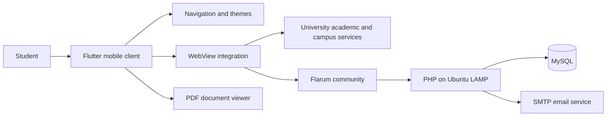

# Delivered System Architecture

## Client and services

The Flutter client implements the navigation shell, pages, themes, web integrations and document viewing. It connects to university services and the team's Flarum deployment on a Google Cloud Ubuntu instance with PHP/MySQL and an SMTP provider.

## Requirements to features

| Client need | Delivered route |
|---|---|
| Consolidated student information | Home cards and the four-page navigation |
| Academic learning and administration | Academic service WebViews/links |
| Calendar and timetable access | Timetable entry points and PDF viewing |
| Campus support and bookings | Campus service destinations |
| Student discussion | Embedded Flarum community |
| Consistent visual experience | Shared app bar, navigation and light/dark theme integration |

