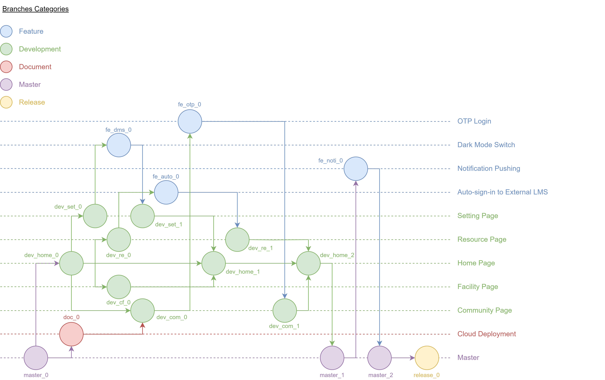

# Branching Strategy

The author's branching plan separates feature, development, document, master and release responsibilities. Feature work is integrated through development branches and peer review before a release is assembled. Naming follows a category, feature/function name and index where applicable.

The development repository contains `master`, `Academic`, `dev_home_0`, `dev_home_1` and `doc_flarum` branches.

The editable [draw.io source](../design/branching-strategy.drawio) accompanies the selected diagram.
